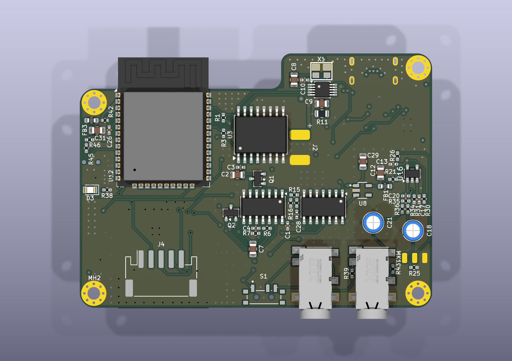
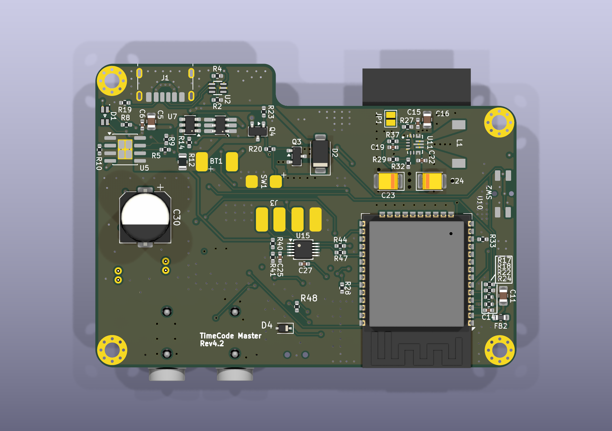
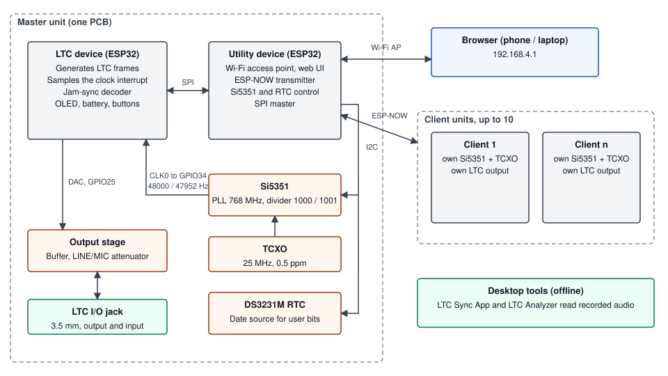

# TimecodeMaster

A wireless SMPTE linear timecode (LTC) generator for film and video sets, built from two ESP32 modules per unit. One master unit holds the time; up to ten client units are jammed to it over ESP-NOW and then run independently on their own TCXO-referenced clock. Each unit produces an LTC audio signal on a 3.5 mm jack for a camera or recorder.

This repository holds everything needed to build and run the system: the KiCad design for the master board, the firmware for all four ESP32 images, and two desktop tools for working with recorded LTC.

| Top (3D render) | Bottom (3D render) |
|---|---|
|  |  |

Board layout views (front, back, and each copper layer) are in [hardware/README.md](hardware/README.md#board-views).

## Frame rates

| Rate | Drop frame | Sample clock | Samples per LTC bit |
|---|---|---|---|
| 23.976 | no | 47952.048 Hz | 25 |
| 24 | no | 48000 Hz | 25 |
| 25 | no | 48000 Hz | 24 |
| 29.97 | selectable | 47952.048 Hz | 20 |
| 30 | no | 48000 Hz | 20 |

The non-integer rates are not approximated. The sample clock itself is divided by 1001, so the LTC frame period is exact and a whole number of samples fits in every bit cell. See [docs/timing.md](docs/timing.md).

## How it works, in short

1. A 25 MHz TCXO feeds an Si5351 clock generator. Its PLL runs at 768 MHz, and a single integer divider produces either 48000 Hz or 47952.048 Hz.
2. That clock is wired to an interrupt pin on the LTC ESP32. Every rising edge writes one sample to the DAC. The bit pattern of the current LTC frame is stepped one sample at a time, so the output frequency is the Si5351 frequency and nothing else.
3. The second ESP32 (the Utility device) runs the Wi-Fi access point and web interface, programs the Si5351, reads the RTC, and talks to the LTC device over SPI.
4. The master sends the time to each client over ESP-NOW, aligned to an LTC frame boundary. After that, every unit keeps time from its own TCXO. Wireless traffic does not steer the clock.
5. A unit can also jam-sync to an external LTC signal fed into the same 3.5 mm jack.

The full description is in [docs/how-it-works.md](docs/how-it-works.md).

The full schematic is in [hardware/docs/schematic.pdf](hardware/docs/schematic.pdf) and the board outputs in [hardware/](hardware/).

## LTC Sync App

During the shoot, each unit records the same LTC onto a camera or recorder audio channel. In post, the [LTC Sync App](docs/ltc-sync-app.md) reads that LTC from the files, places every clip on one timeline by its timecode, and exports the timeline to DaVinci Resolve, Premiere Pro or Final Cut Pro X. It reads the date and a two-digit camera ID that the units write into the LTC user bits, handles 23.976 and 29.97 exactly, and can correct per-camera offsets and a recorder's clock drift. Usage is described in [docs/ltc-sync-app.md](docs/ltc-sync-app.md).

## Repository layout

| Path | Contents |
|---|---|
| [hardware/](hardware/) | KiCad projects (main board, button boards), schematic PDF, BOM, released Gerbers, STEP models |
| [firmware/](firmware/) | Four Arduino sketches: master LTC, master Utility, client LTC, client Utility |
| [software/ltc-sync-app/](software/ltc-sync-app/) | Desktop app that reads LTC from video and audio files, aligns clips, and exports timelines |
| [software/ltc-analyzer/](software/ltc-analyzer/) | Desktop tool that decodes LTC from a live input or a file and reports continuity and drift |
| [docs/](docs/) | Architecture, timing, hardware notes, pinout, protocols, build and operation guides |

## Documentation

| Document | Subject |
|---|---|
| [docs/how-it-works.md](docs/how-it-works.md) | Architecture, clocking, synchronisation, jam sync, power |
| [docs/timing.md](docs/timing.md) | LTC format, non-integer frame rates, drop frame, drift budget |
| [docs/hardware.md](docs/hardware.md) | Circuit description of the master board |
| [docs/pinout.md](docs/pinout.md) | GPIO assignments for every ESP32 image, connector pinouts |
| [docs/protocol.md](docs/protocol.md) | SPI link, ESP-NOW messages, HTTP and WebSocket interface |
| [docs/firmware.md](docs/firmware.md) | Toolchain, libraries, build, first flash, over-the-air updates |
| [docs/operation.md](docs/operation.md) | Pairing, syncing, buttons, jam sync, battery, troubleshooting |
| [docs/ltc-sync-app.md](docs/ltc-sync-app.md) | Using the LTC Sync App to align footage and export timelines |
| [docs/design-notes.md](docs/design-notes.md) | Why the classic ESP32 was used (cost and the DAC), why the DAC ended up unused, and what an ESP32-S3 would change |
| [docs/field-test.md](docs/field-test.md) | One real shoot: what the LTC Sync App read from the files |
| [docs/security.md](docs/security.md) | Wi-Fi password, web interface, ESP-NOW and OTA: what is and is not protected |
| [hardware/README.md](hardware/README.md) | Design files, BOM, fabrication status |

## Quick start

Requirements: Arduino IDE 2.x or `arduino-cli`, the `esp32` board package (3.x), and the libraries listed in [docs/firmware.md](docs/firmware.md).

1. Build and flash the two master images (`master_LTC_Device_Jamsync` to the LTC module, `Master_Utility_Device_JamSync_Wireless` to the Utility module). Use board "ESP32 Dev Module" and the "Default 4MB with spiffs" partition scheme.
2. Build and flash the two client images the same way (`Client_LTC_Device`, `Client_Utility_Device_Wireless`).
3. Power the master. Join the Wi-Fi network `TimecodeMaster-XXXX`, open `http://192.168.4.1`, and start pairing.
4. Power a client, confirm it on the master page, and press Sync.

Details, including the password and button gestures, are in [docs/operation.md](docs/operation.md).

## Status

- Firmware version 1.3.37 for the master Utility image and 1.3.34 for the other three. See [CHANGELOG.md](CHANGELOG.md).
- The main board is now Rev 4.2. The KiCad sources in `hardware/kicad/main-board` and the Gerbers in `hardware/fabrication/main-board-rev4.2` are Rev 4.2; the Rev 4.2 set has not been used for an order yet. The released Rev 4.1 Gerbers are kept in `hardware/fabrication/main-board-rev4.1`. See [hardware/README.md](hardware/README.md).
- The current KiCad source adds an ESD diode (D4) and a series resistor (R48) on the LTC I/O jack. The Rev 4.1 Gerbers do not include them; the Rev 4.2 set does. The microphone jack and the LTC jack's ring contact are not protected.
- Only the master board has a PCB design in this repository. The client firmware targets the same two-ESP32 architecture, but its Utility image uses a few different GPIOs (see [docs/pinout.md](docs/pinout.md)).
- The firmware has little security. The web interface has no login, ESP-NOW is unencrypted, and the OTA password is a fixed string. See [docs/security.md](docs/security.md).
- The firmware has not been certified against any broadcast standard. Check the output against your own equipment, for example with the LTC Analyzer in this repository.

## Authorship

The firmware in this repository was written by AI. The hardware (schematic and PCB) was designed by me, and the testing of the units was done by me. Read the firmware with that in mind and check it on your own hardware before relying on it.

## License

Source-available under the [PolyForm Noncommercial License 1.0.0](LICENSE), with an [additional permission](ADDITIONAL-PERMISSION.md). Personal, hobby, study and other noncommercial use is free. Small independent users (total business revenue under US$100,000 a year, for example photographers, videographers and indie filmmakers) may also use it on their own paid work for free. Everyone else using it commercially, and anyone selling or renting units, boards, firmware or software, needs a separate paid license. See [COMMERCIAL.md](COMMERCIAL.md). This is not an OSI-approved open source license.

Required notice: see [NOTICE](NOTICE). Material from other people (KiCad and part libraries, the libraries the firmware needs) keeps its own terms; see [THIRD-PARTY.md](THIRD-PARTY.md).
