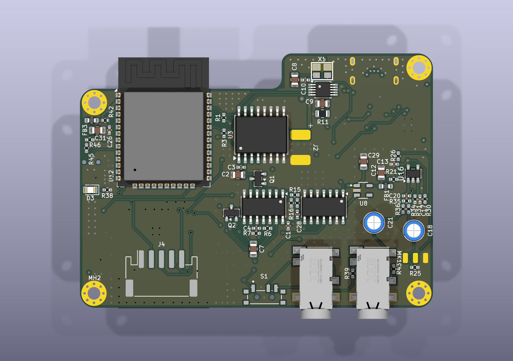
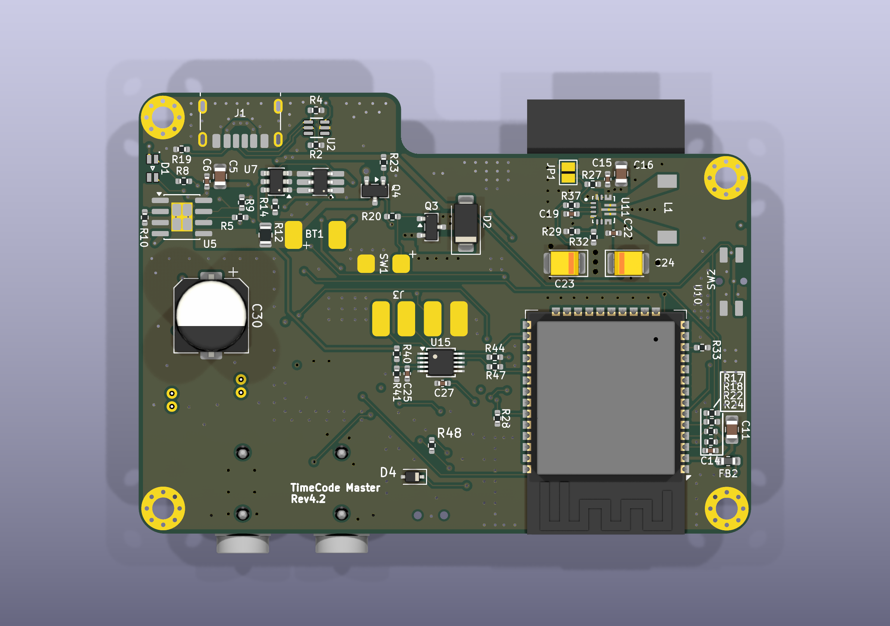
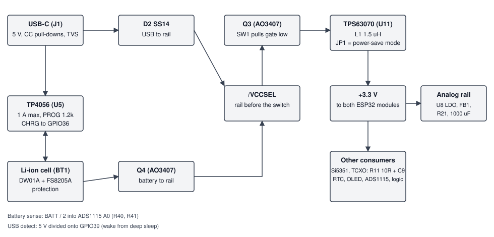
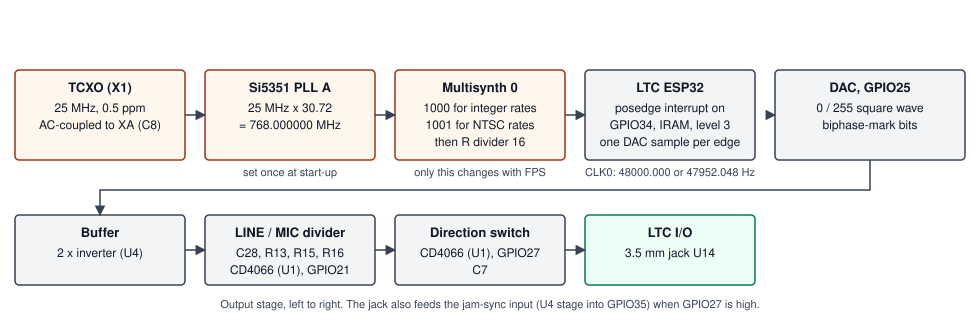

# Hardware: master board

This document describes the circuit in `hardware/kicad/main-board` (KiCad 9, title block "TimeCode-Master", 4-layer, 70.0 x 50.5 mm, 1.6 mm). Reference designators below are the ones in the current schematic. The PDF is at [hardware/docs/schematic.pdf](../hardware/docs/schematic.pdf).

## Block list

| Block | Parts |
|---|---|
| LTC device | U10, ESP32-WROOM-32E |
| Utility device | U12, ESP32-WROOM-32E |
| Reference and clock generator | X1 (25 MHz 0.5 ppm TCXO, TSX-3225), Y1 (Si5351A-B-GT) |
| Real-time clock | U3 (DS3231M), J2 (backup battery pads) |
| Battery ADC | U15 (ADS1115) |
| Output / input stage | U4 (74HC14), U1 (CD4066), Q1, Q2, S1, U14 (3.5 mm jack), D4 and R48 (jack protection) |
| Microphone path | MK1 (electret), U16 (OPA365), U13 (3.5 mm jack) |
| Power input and charging | J1 (USB-C, power only), U2 (TVS), U5 (TP4056), U7 (DW01A), U6 (FS8205A), D1 (charge LED) |
| Power path and regulation | D2, Q3, Q4, SW1, U11 (TPS63070), L1, U8 (RT9013-33), FB1 to FB3 |
| User interface | J3 (OLED), J4 (button board), SW2 (OTA), D3 (status LED) |

## Power

**USB input.** J1 is a power-only USB-C receptacle. R2 and R4 (5.1 kOhm) on CC1 and CC2 identify the unit as a sink. U2 (SMF05CT1G) clamps transients.

**Charging.** U5 (TP4056) charges the Li-ion cell at up to 1 A. The programming resistor R10 is 1.2 kOhm, which sets 1 A (I = 1200 / R in kOhm). The charge and standby outputs drive the two elements of D1 through R8 and R5 (1 kOhm each). The charge output also goes to GPIO36 of the LTC device, with two pull-ups, R22 (100 kOhm, to the module supply) and R9 (20 kOhm, to 3.3 V), so the firmware can read "charging" (low). The cell is protected by U7 (DW01A) and U6 (FS8205A) in its negative lead.

**Source selection.** D2 (SS14) feeds the rail `/VCCSEL` from the 5 V input. Q4 (P-channel, drain on the battery, gate pulled to 5 V through R23) connects the battery to the same rail through its body diode when USB is absent and turns off when USB is present. The higher source wins.

**Power switch.** Q3 (P-channel) passes `/VCCSEL` to `VCC` when its gate, held up by R20 (47 kOhm), is pulled low by SW1. SW1 is a pad pair for the slide switch on the power-switch board.

**3.3 V rail.** U11 (TPS63070 buck-boost, L1 = 1.5 uH) converts `VCC` to 3.3 V. The output voltage is set by R32 (470 kOhm) and R29 (150 kOhm) at FB. The converter's power-save pin is pulled high by R27 (forced PWM, lower ripple). Closing the solder jumper JP1 ties it low and enables power-save mode, which lowers the quiescent current at the cost of ripple. PG is pulled up by R37 but not used elsewhere.

**Local filtering.** Each ESP32 module has its own ferrite bead (FB2 for the LTC device, FB3 for the Utility device) and a 22 uF capacitor (C11, C31). The Si5351 and the TCXO share a supply node filtered by R11 (10 Ohm) with C9 and C10.

**Analog rail.** U8 (RT9013-33, a 3.3 V LDO) is fed from the 3.3 V rail, then passes through FB1 and R21 (20 Ohm) to a 1000 uF capacitor (C30). This rail supplies the microphone preamp U16 and its bias network.

**Battery sense.** R40 and R41 (100 kOhm each) divide the cell voltage by two into AIN0 of U15 (ADS1115, address 0x48, ADDR tied to GND). C25 filters the input. The firmware multiplies the reading by two and applies thresholds (3.8, 3.6, 3.4, 3.2 V for the four bar levels, shutdown at 3.1 V).

**USB detect / wake.** The 5 V rail is divided down to a wake pin on each ESP32 (GPIO39). For the LTC device the divider is R17 = 10 kOhm and R18 = 20 kOhm (3.3 V at 5 V in). For the Utility device it is R45 = R46 = 20 kOhm (2.5 V). The firmware uses these pins as deep-sleep wake sources (`esp_sleep_enable_ext0_wakeup`, level high).

## Clock

- X1 (TSX-3225, 25 MHz, 0.5 ppm) is powered from the filtered Si5351 supply node. Its output is AC-coupled by C8 (10 nF) into XA of Y1. XB is unconnected.
- Y1 is controlled over the Utility I2C bus (GPIO21 SDA, GPIO22 SCL), address 0x60. Only CLK0 is used.
- CLK0 goes straight to GPIO34 of the LTC device. GPIO34 is an input-only pin, which suits this use. CLK1 and CLK2 are unconnected.
- The PLL and divider values are in [timing.md](timing.md).

## LTC output and input stage

The output path, from the DAC to the jack:

1. GPIO25 (DAC1) drives U4 pins 1 to 4: two Schmitt inverters in series, which restore a full-swing square wave. The DAC was first meant to set the output level directly, but it proved too noisy for that, so it only writes two levels here and the level is set by the divider below.
2. C28 (1 uF) blocks DC. The signal enters a divider: R13 (15 kOhm) from the coupling capacitor to node A, R15 (15 kOhm) from node A to node B, R16 (1 kOhm) from node B to ground.
3. U1 (CD4066) contains four analog switches. Two of them connect either node A or node B to the output node. GPIO21 drives switch 1 directly and switch 2 through Q2 (an inverter stage), so exactly one is closed. GPIO21 high selects node A (LINE), low selects node B (MIC). Node B is (R15 + R16) / R16 = 16 times (24 dB) lower than node A.
4. The other two switches in U1 are controlled by GPIO27: one (through the inverter Q1) connects the output node to the jack, the other (directly) connects the jack to the input stage. GPIO27 low is output; GPIO27 high (jam sync, SEARCHING state) is input. The jack side is coupled with C7 (10 uF).

The input path (jam sync): with GPIO27 high, the jack is routed through C4 (100 nF) into U4 pin 11. R6 (100 kOhm to 3.3 V) and R7 (68 kOhm to ground) bias the input. Two Schmitt inverters (U4 pins 11 to 10 and 9 to 8) square up the edges and the result goes to GPIO35 (input-only), which has an any-edge interrupt. The remaining gates of U4 are unused and their inputs are tied to ground.

**Jack protection.** D4 (PESD5V0S1BA, a bidirectional 5 V ESD diode in SOD-323) connects the tip of the LTC I/O jack to ground, directly on the jack net. R48 (1 kOhm) sits between that net and C7, so everything behind it, the CD4066 switches and the 74HC14 input, sees only the current that gets past the diode. The signal is AC around 0 V, which is why the diode is bidirectional. R48 is in series with both the output and the jam-sync input. The ring contact of U14 and the microphone jack U13 have no protection.

U14 (LTC I/O) and U13 (microphone) are both PJ-342B 3.5 mm jacks. In the symbol, pins 3 and 6 are the ring and tip springs, pins 4 and 5 are the normally closed switch contacts under them, and pins 2 and 7 are ground (sleeve).

**LTC jack, S1 and the ring.** The tip of U14 (pin 6) carries the LTC I/O net. The ring (pin 3) goes to S1. S1 (SSSS811101) is a mechanical slide switch with a common pin (pin 2, to the ring of U14) and two throws: pin 1 is the LTC tip net, and pin 3 is the microphone node. In one position the ring carries a copy of the LTC signal (ring tied to tip). In the other it carries the microphone signal. So one stereo cable can carry LTC on the tip and the microphone on the ring, or LTC on both. The schematic does not mark which direction of the slider is which.

**Microphone jack U13.** The on-board microphone signal, Mic-Output (U16 through R36 and C21), is wired to the normally closed contacts of U13 (pins 4 and 5). As drawn, with nothing plugged in it reaches the springs (pins 3 and 6) and, through R39 and R43 (4.7 kOhm each, joined on one node), the microphone node at S1. Inserting a plug opens those switch contacts, which disconnects the on-board microphone and puts the plug's tip and ring on the springs instead. R39 and R43 add the tip and ring together into one mono signal, so an external microphone is mono only: use a mono plug. Nothing in the circuit supplies a bias voltage to U13 (the on-board capsule MK1 is biased inside the unit by R26), so a microphone that needs plug-in power from the jack will not work.

The AO3407 transistors Q1 and Q2 act as inverters between the GPIO lines and two of the CD4066 control pins. Both have their source on the 3.3 V rail.

## Microphone path

MK1 (DR1409B electret) has its drain supplied from the analog rail through R26 (4.7 kOhm) and its source resistor R25 (4.7 kOhm) to ground. The signal is taken from the source through C18 and R34 (10 kOhm) into the inverting input of U16 (OPA365, a single rail-to-rail op-amp specified for 2.2 to 5.5 V). The feedback network is R35 (100 kOhm) with C20 (10 pF), so the gain is about 10 (-10 inverting). The output goes through R36 (100 Ohm) and C21 (10 uF) to U13. The half-supply bias is built from R30 and R31 (20 kOhm) and C17.

This path is independent of the LTC path. The firmware does not use the microphone.

## Utility peripherals

| Part | Interface | Address |
|---|---|---|
| Si5351A | I2C, GPIO21 / GPIO22 | 0x60 |
| DS3231M | I2C, GPIO21 / GPIO22 | 0x68 |

R1 and R3 (4.7 kOhm) are the pull-ups for this bus. The DS3231M VBAT pin goes to J2 for a backup cell. The INT/SQW, 32 kHz and RST pins are unconnected.

The firmware serialises access to the shared bus with a mutex, and clocks out a stuck SDA line (nine SCL pulses and a STOP) at start-up.

## LTC device peripherals

| Part | Interface | Address |
|---|---|---|
| OLED (SSD1306, 128 x 64 on the master, 128 x 32 on the client) | I2C, GPIO5 SDA / GPIO4 SCL, via J3 | 0x3C |
| ADS1115 | same bus | 0x48 |

R44 and R47 (4.7 kOhm) are the pull-ups. J3 has four pins: GND, 3.3 V, SCL, SDA.

## SPI link

Both modules use the same four GPIOs (12 MISO, 13 MOSI, 14 SCLK, 15 CS) and are connected pin to pin. The Utility is the SPI master. GPIO12 and GPIO15 are ESP32 strapping pins, which is relevant if anything else is attached to those nets.

## Controls and indicators

| Item | Connection | Function |
|---|---|---|
| J4 (JST PH, 5 pin, side entry) | GND, SYNC, WIFI, LVL, FPS | Control button board |
| SW2 | Utility GPIO33 to GND | OTA mode |
| SW1 pads | `G-Switch` to GND | Power |
| D1 (bi-colour LED) | TP4056 CHRG and STDBY | Charge state |
| D3 (blue LED) | Utility GPIO2 through R38 (47 Ohm) | Status |
| JP1 | TPS63070 PS/SYNC to GND | Power-save mode |

The two small boards are in `hardware/kicad/control-button-board` (four tactile switches and the mating 5-pin connector) and `hardware/kicad/power-switch-board` (the slide switch, TL2285EE).

## Resets and boot

Each ESP32 EN pin has a 10 kOhm pull-up and a 100 nF capacitor (R24 and C14, R42 and C26). The schematic shows no programming header and no connection to the UART or to GPIO0 on either module. Initial flashing therefore has to be done by contacting the module pads directly, or before the module is soldered. After that, firmware is updated over the air (see [firmware.md](firmware.md)).

## Items worth checking on a new build

These are observations from reading the netlist, not confirmed faults.

- The Utility wake divider (R45 / R46) gives 2.5 V from 5 V, which is close to the ESP32 input-high threshold (0.75 x VDD = 2.5 V). The LTC divider gives 3.3 V.
- The netlist shows no pull-down on the drains of Q1 and Q2, which drive CD4066 control pins 6 and 5. When the transistor is off, that control pin has no defined level. Check the LINE/MIC selection and the jack direction on the bench in both states.
- The slider direction of S1 is not marked in the schematic. The U13 behaviour above is read from the symbol and the netlist, not measured on a board.
- Output levels. The divider (R13 and R15 15 kOhm, R16 1 kOhm) gives about 1.7 Vpp unloaded on LINE (source impedance about 7.7 kOhm) and about 0.1 Vpp on MIC (about 1 kOhm). R48 adds 1 kOhm in series on top of that, and the CD4066 on-resistance at 3.3 V is not included. On MIC that is roughly 1 to 3 dB less at the camera, depending on its input impedance. The level cannot be changed in firmware, because the DAC feeds the 74HC14 buffer, which restores a full swing. To raise the MIC level, increase R16 (2.2 kOhm gives about 6.6 dB more), lower R48, or raise the camera's gain. Measure the output at the camera.
- The jack protection covers the LTC jack tip only. The ring contact (U14 pin 3, through S1) and the microphone jack U13 have no ESD diode. Rev 4.1 boards have none of the protection.
- The BOM mixes 0402 and 0805 footprints for the 10 uF capacitors and two electrolytic footprints (C18 radial through-hole, C30 8x10 SMD). Check availability and heights against the enclosure.
- Rev 4.1 boards carry an OPA1656 as the microphone preamp, on the 3.3 V analog rail. Its datasheet minimum supply is 4.5 V, so it is out of specification there. The firmware does not use the microphone, so nothing depends on it. The current source uses an OPA365 (U16, SOT-23-5), which is specified from 2.2 V. Check both datasheets before relying on either.
- The Gerbers in `hardware/fabrication/main-board-rev4.1` are the older Rev 4.1 set and do not match the current source. The Rev 4.2 set is in `hardware/fabrication/main-board-rev4.2` (see [hardware/README.md](../hardware/README.md)).
