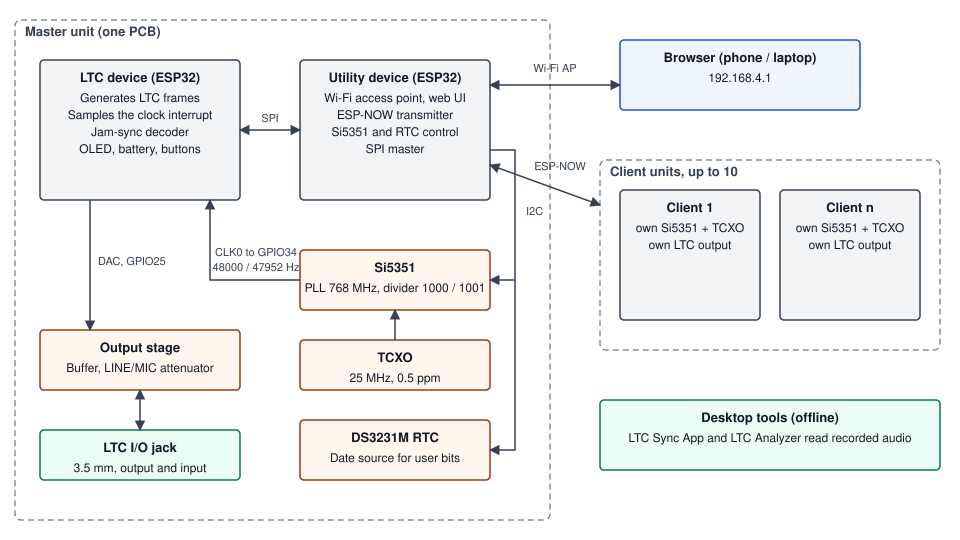
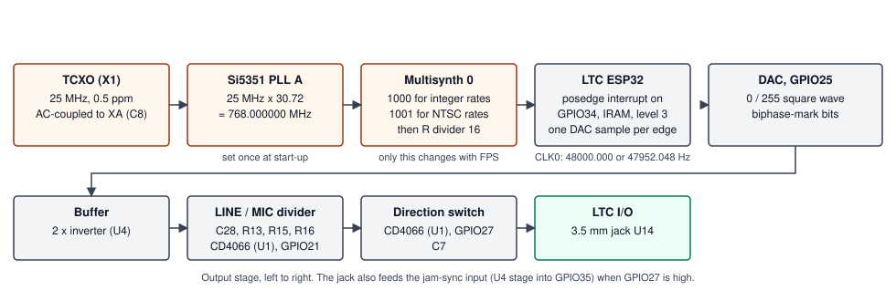
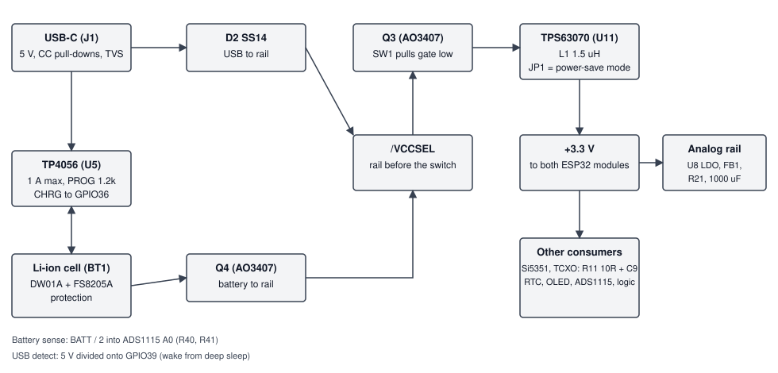

# How it works

## 1. Two processors per unit

Every unit, master or client, contains two ESP32-WROOM-32E modules that are wired together by SPI. The split exists to keep the timing-critical work away from the radio.

| Module | Role | Runs |
|---|---|---|
| LTC device | Slave on SPI | The sample-clock interrupt, LTC frame generation, DAC output, jam-sync decoder, OLED, battery monitor, front-panel buttons |
| Utility device | Master on SPI | Wi-Fi access point and web server (master), ESP-NOW, Si5351 and RTC control, pairing, over-the-air updates |

Wi-Fi and ESP-NOW interrupt the CPU in bursts and take flash locks. Putting them on a separate chip means the LTC device never has to share a core with the radio stack. The LTC device still keeps its interrupt code in IRAM, so flash operations (NVS writes, OTA) cannot delay it. `firmware/tools/check_isr_flash_safe.py` checks this after every build.

The four firmware images are:

| Image | Chip | Unit |
|---|---|---|
| `master_LTC_Device_Jamsync` | LTC device | master |
| `Master_Utility_Device_JamSync_Wireless` | Utility device | master |
| `Client_LTC_Device` | LTC device | client |
| `Client_Utility_Device_Wireless` | Utility device | client |

## 2. Clocking

LTC audio is produced one sample at a time from a hardware clock, not from a software timer.

1. A 25 MHz, 0.5 ppm TCXO (X1) is the only frequency reference in the unit.
2. The Si5351 multiplies it to a 768.000000 MHz VCO (25 MHz x 30.72, which the Si5351 can represent exactly). This is programmed once at start-up.
3. Multisynth 0 divides the VCO by 1000 or 1001, and the output divider R divides by 16 again:
   - 768 MHz / (1000 x 16) = 48000.000 Hz
   - 768 MHz / (1001 x 16) = 47952.048 Hz (48 MHz / 1001)
4. Only the multisynth integer changes when the frame rate changes. The PLL stays locked, so a frame-rate change does not cause a relock glitch.
5. CLK0 goes to GPIO34 on the LTC device. A rising-edge interrupt (IRAM, interrupt level 3) runs for every pulse. The handler advances a sample counter, toggles the output level at the right sample, and writes the DAC.

Because the handler runs once per clock edge, the LTC signal frequency is the Si5351 frequency divided by an integer. Jitter in the handler's start time moves a single edge by a few hundred nanoseconds but cannot accumulate, since the next edge is again triggered by the hardware clock.

The LTC device also counts the pulses it receives against the CPU cycle counter in 2048-pulse windows. A window that has too few or too many pulses is logged, which exposes missed interrupts or ringing on the clock line. The result is reported to the master and shown on its firmware page.

## 3. LTC generation

LTC is an 80-bit frame sent as biphase-mark code: every bit cell starts with a transition, and a one has a second transition in the middle of the cell. The interrupt handler produces this directly.

- A bit cell is a fixed number of samples (20, 24 or 25, see the table in the README), so the mid-cell and end-of-cell transitions fall on whole-sample boundaries.
- At the end of the 80th bit the handler increments the frame counter, handles second, minute and hour rollover, applies drop-frame skipping when enabled, and copies the next pre-built frame into the active buffer.
- A high-priority task on core 1 builds each frame ahead of time (BCD digits, drop-frame flag, user bits, sync word), so the handler only copies 80 bytes.
- The DAC is driven between 0 and 255 as a square wave. The analog stage (section 6) shapes the amplitude.

Frame contents:

- Time of day in BCD, frame number, drop-frame flag.
- User bits (8 nibbles): month, day and year from the RTC, then a two-character camera ID. The date rolls over in the LTC device at midnight without a new message from the master.
- The standard sync word in bits 64 to 79 (0011 1111 1111 1101).

An optional output offset of -30 to +30 frames can be set per unit. It shifts only the timecode written into the signal, not the unit's own time, so cameras with different audio-path latency can be matched.

## 4. Synchronising the units

The master keeps time in its own LTC device. There is no continuous wireless clock correction. A client is told the time once and then runs on its own TCXO.

Pairing:

1. On the master's web page, start pairing mode (60 s).
2. Unpaired clients broadcast a request on channel 1. The master lists them by MAC address.
3. Confirming a client sends it a pairing message. Both sides store the peer in NVS and the client then registers with a periodic heartbeat (every 5 s).

Time transfer:

1. The master waits for the start of an LTC frame, polls its LTC device for the exact timecode, and adds one frame to cover the radio and SPI delay.
2. It sends a `SYNC` message to each paired client, one after another, about 100 microseconds apart.
3. The client's Utility device forwards the time to its LTC device over SPI directly from the radio callback, without queueing it through a task, so that no extra scheduling delay is added.
4. The client LTC device loads the time and restarts its bit counter at the start of a frame.

A client is resynchronised when it first registers, when its uptime goes backwards (it rebooted), when the master boots, when the user presses Sync, and at the optional automatic interval (off by default). Clients that are in jam-sync mode or locked ignore `SYNC` and `RUN` messages.

The frame-rate, drop-frame flag and sample rate travel in the same message. A client reprograms its own Si5351 multisynth when the sample rate changes.

Why the units stay together: all of them divide a 0.5 ppm reference by exact integers. Two units that start at the same instant diverge by at most about 1 ppm in the worst case, which is roughly 3.6 ms per hour (a tenth of a frame at 30 fps). See the drift budget in [timing.md](timing.md). Resync before long takes if tighter agreement is needed.

## 5. Jam sync to an external LTC source

A unit can take its time from an external LTC signal, for example a sound recorder's timecode output, fed into the same 3.5 mm jack that normally carries its own output. A long press (3 s) of the LEVEL button starts it.

Sequence:

1. The unit enters SEARCHING. Its own LTC output stops, GPIO27 goes high, and the analog switch (U1) connects the jack to the input conditioning stage (Schmitt inverters in U4). The signal arrives on GPIO35, which has an any-edge interrupt. The OLED shows `JSRC`.
2. The interrupt measures the time between edges and classifies each interval as a half-bit or full-bit cell (half: 170 to 310 us, full: 360 to 580 us), which builds the bit stream and gives an estimate of the frame rate.
3. When the 16-bit sync word appears in the stream, its end marks the frame boundary at once ("instant lock"). The decoded time is checked on a second consecutive frame (the build requires 2 consecutive valid frames).
4. On success the unit loads the decoded time, advances it for the frame that has passed, restarts its bit counter in phase with the external frame, and resumes output. GPIO27 goes low so the jack is an output again, and the input interrupt is detached.
5. The unit is now in the free-run state (`JRUN` on the OLED) and runs from its own TCXO-derived clock, as every unit does. It is also placed in the lock state, which blocks the front-panel buttons so the jammed time cannot be changed by accident, and which switches off the access point, ESP-NOW and the web server.

Pressing the LEVEL button for 3 s again leaves jam-sync mode; the unit keeps running.

There is no continuous following of the external source. The jam transfers the time once, exactly like a wireless sync from the master, and the accuracy afterwards is the TCXO's.

While a unit is in SEARCHING or in free-run after a jam, it ignores `SYNC` and `RUN` messages from the master, and the master does not send `SYNC` to it.

States:

| State | OLED | Meaning |
|---|---|---|
| DISABLED | `MASTER` | Normal generation |
| SEARCHING | `JSRC` | Output stopped, decoding the external signal |
| FREERUN | `JRUN` | Jammed; running from the unit's own clock |
| (system lock) | `LOCKED` | Buttons and wireless disabled; also entered by a 5 s press of the FPS button |

## 6. Output and input stage

The DAC output goes through:

1. U4 (two inverters in series) as a buffer.
2. A series capacitor (C28) and a resistor divider (R13, R15, R16).
3. CD4066 analog switches (U1) that pick the tap of the divider. GPIO21 selects the tap: high for LINE level, low for MIC level. The LINE and MIC DAC values are identical in firmware, the level difference is entirely in this network.
4. A second switch pair in U1, controlled by GPIO27, that connects either the output stage or the input stage to the jack through C7.

The circuit details are in [hardware.md](hardware.md).

## 7. Power

- USB-C provides 5 V. A TP4056 charges a single Li-ion cell at up to 1 A (set by R10 = 1.2 kOhm). A DW01A and FS8205A protect the cell.
- A Schottky diode (D2) and a P-channel MOSFET (Q4) combine USB and battery into one rail. SW1 enables the rail through Q3.
- A TPS63070 buck-boost generates the 3.3 V system rail from either source.
- The ADS1115 measures the cell voltage through a divide-by-two network. The LTC device shows a four-level indicator and shuts the unit down at 3.1 V (resume threshold 3.2 V, 5 s of stable reading, 10 s start-up grace). Charge status comes from the TP4056 on GPIO36.
- A deep-sleep wake pin (GPIO39) is driven by a divider from the 5 V rail.

An optional radio power-save mode puts clients' radios to sleep between 2 s beacons from the master. It is off by default and is set from the master's main page.

## 8. Web interface and updates

The master Utility serves a single-page web interface (HTTP on port 80, WebSocket on `/ws`) from its own access point, `TimecodeMaster-XXXX` at 192.168.4.1. It shows live timecode, the RTC, each client's state, battery, signal strength and firmware version, and it exposes the controls: frame rate, drop frame, set time, set RTC from the phone's clock, start and stop, pairing, sync interval, LTC output offset, and radio settings.

Firmware can be replaced over the air for all four images:

- The Utility device accepts an uploaded image in OTA mode (hold the OTA button for 3 s).
- The master LTC image is streamed to the LTC chip by the master Utility over SPI, in checked packets (offset, CRC16), then verified by MD5 and an identity tag before it is committed.
- The master can push a client image to selected clients over ESP-NOW, one at a time or up to four at once. Every image carries an identity tag (`TCM-FWID:...`) that is checked first, so a wrong file cannot be installed on a whole fleet.

See [firmware.md](firmware.md).
