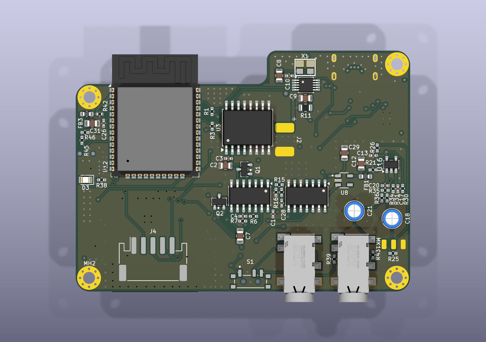
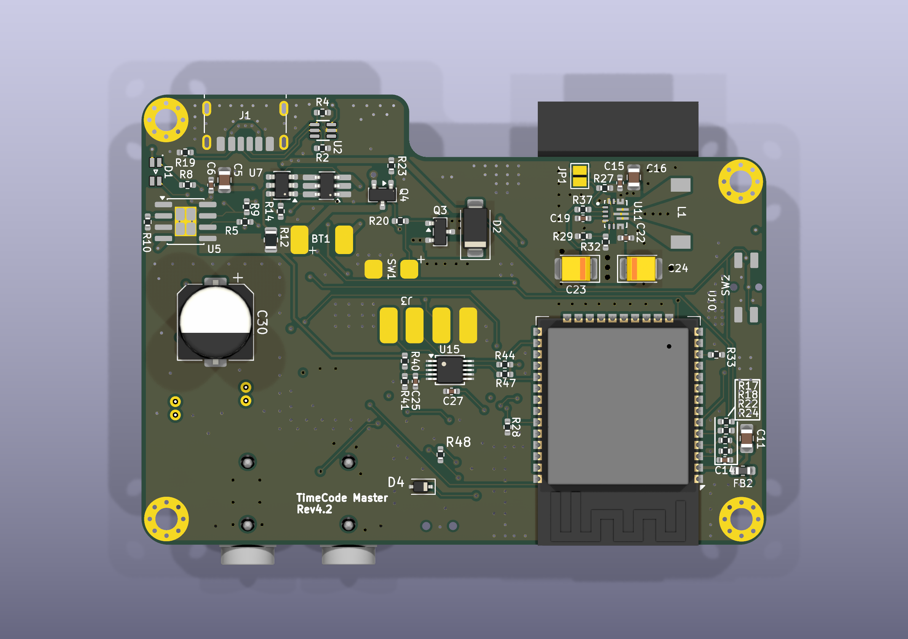
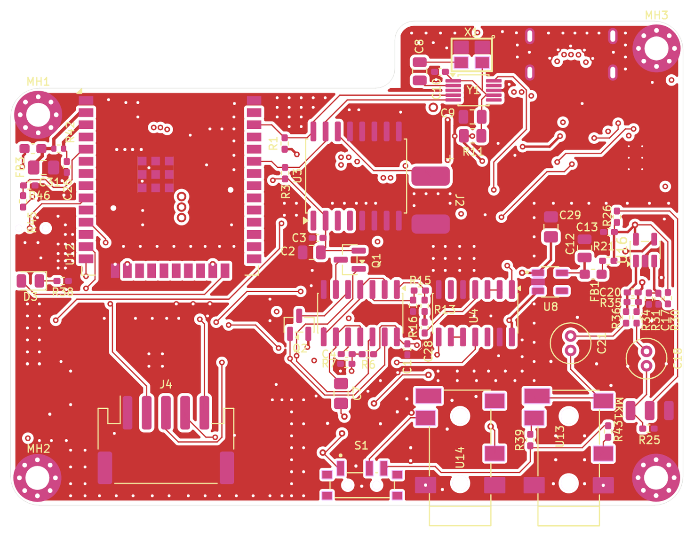
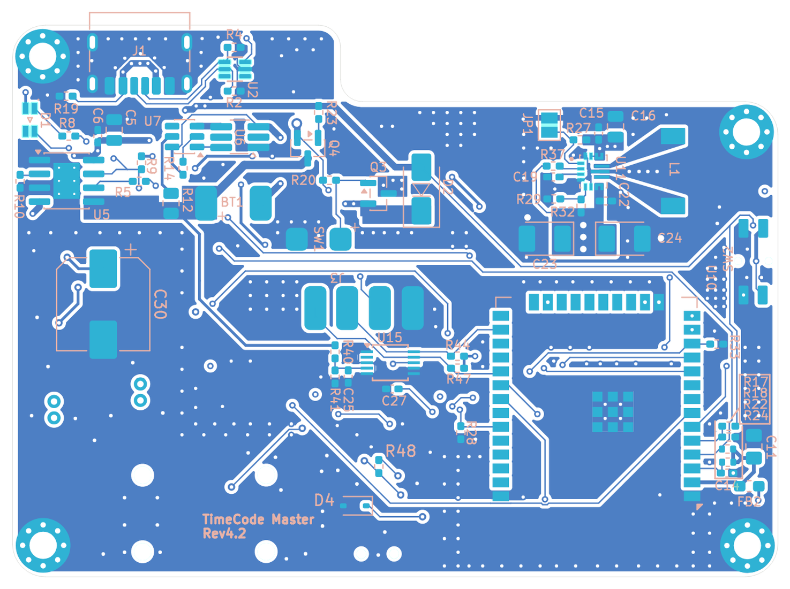
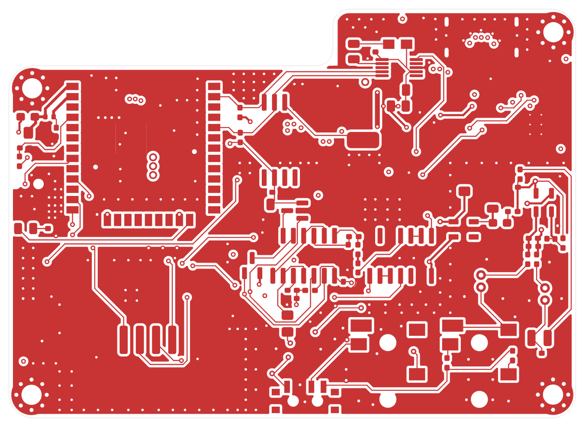
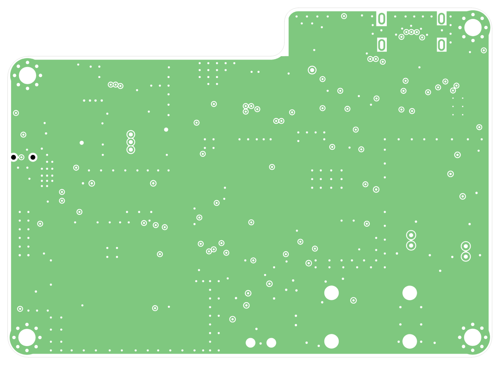
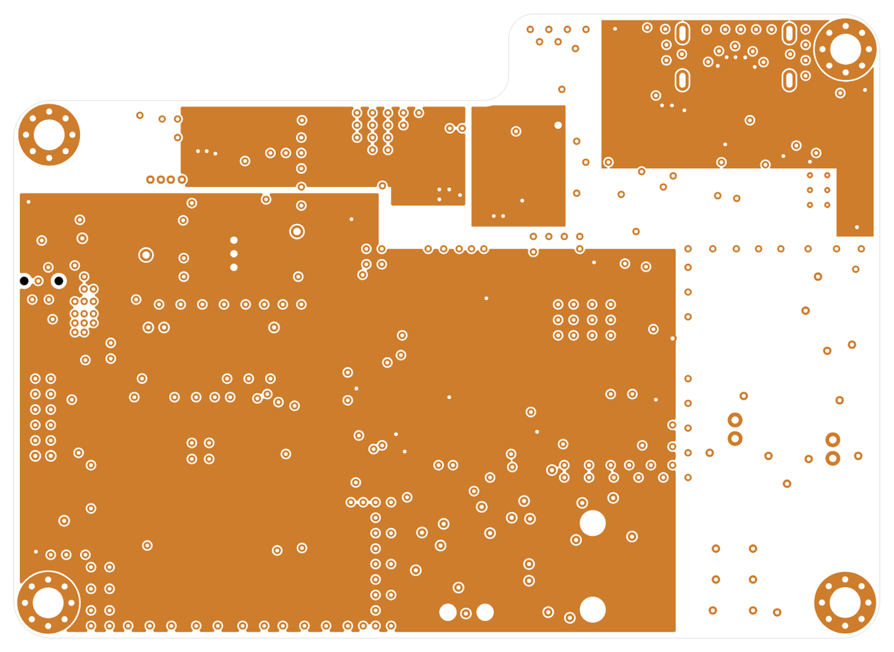
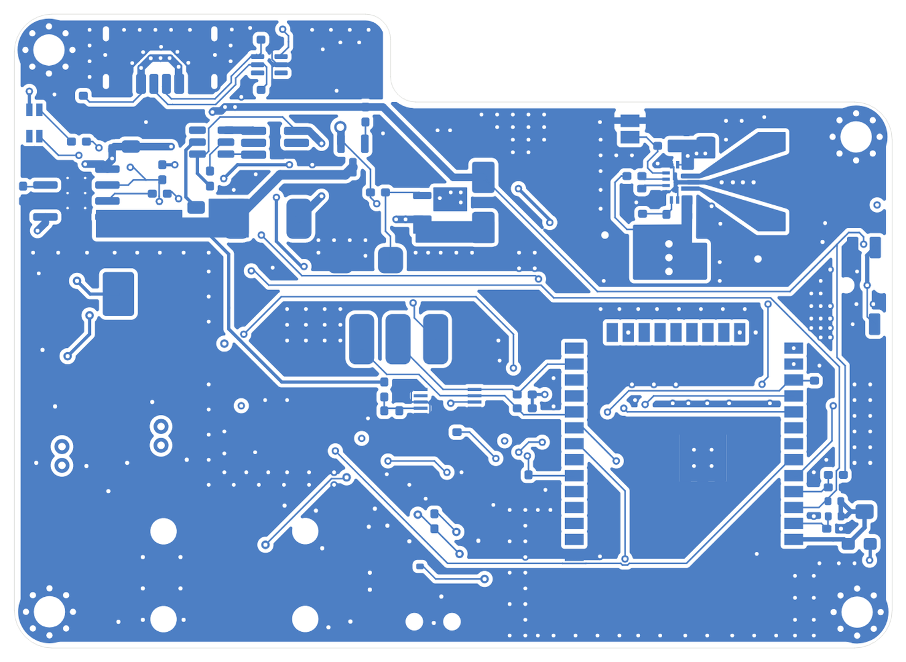

# Hardware

KiCad 9 design files, outputs and manufacturing data for the TimecodeMaster main board and its two small accessory boards. The circuit is described in [../docs/hardware.md](../docs/hardware.md) and the pin assignments in [../docs/pinout.md](../docs/pinout.md).

The schematic as a PDF: [docs/schematic.pdf](docs/schematic.pdf). Board views are below.

## Board views

3D renders from KiCad (top and bottom):

| Top | Bottom |
|---|---|
|  |  |

Layout views (copper, mask and silkscreen). The back view is mirrored, as seen from the back of the board:

Individual copper layers (the back layer is mirrored):

| Front (F.Cu) | Inner 1 (In1.Cu) |
|---|---|
|  |  |

| Inner 2 (In2.Cu) | Back (B.Cu) |
|---|---|
|  |  |

All views come from the current PCB source (Rev 4.2), not from the Rev 4.1 Gerbers (see Fabrication status below).

## Contents

| Path | Contents |
|---|---|
| `kicad/main-board/` | Project, schematic and PCB of the master board (title block "TimeCode-Master") |
| `kicad/control-button-board/` | Four tactile switches (FPS, LEVEL, WIFI, SYNC) and the 5-pin connector that plugs into J4 |
| `kicad/power-switch-board/` | The slide power switch (TL2285EE) on the `G-Switch` net |
| `fabrication/main-board-rev4.1/` | Gerber and drill files of the released Rev 4.1 boards, generated 2026-02-10 with KiCad 9.0.5 |
| `fabrication/main-board-rev4.2/` | Gerber and drill files of Rev 4.2, plotted from the current source on 2026-11-20 with KiCad 9.0.5 |
| `fabrication/control-button-board/`, `fabrication/power-switch-board/` | Gerber and drill files for the accessory boards |
| `cad/` | STEP models of the main board and the button boards |
| `docs/` | Schematic (PDF, SVG) and board renders |
| `bom.csv` | Bill of materials for the main board, generated from the schematic |
| `scripts/` | `export.sh` regenerates the PDF, SVG, renders and BOM; `make_bom.py` builds the BOM from a netlist |

## Board

| Item | Value |
|---|---|
| Size | 70.04 x 50.54 mm |
| Layers | 4 (F.Cu, In1.Cu, In2.Cu, B.Cu), 1.6 mm |
| Minimum track / space (released Gerbers) | 0.127 mm |
| Main parts | 2 x ESP32-WROOM-32E, Si5351A, 25 MHz TCXO, DS3231M, ADS1115, TPS63070, TP4056, OPA365 |
| Mounting | 4 x M2.5 holes |

Symbols and footprints, including the custom ones (TSX-3225, SMF05C, PJ-342B, the RGB LED, the TL2285EE switch), are embedded in the schematic and board files.

## Fabrication status

Two Gerber sets are kept:

- `fabrication/main-board-rev4.1` was released on 2026-02-10. It does not match the current source and is kept for reference.
- `fabrication/main-board-rev4.2` is Rev 4.2, plotted from the current source in `kicad/main-board` on 2026-11-20 (4 layers, 70.04 x 50.54 mm, outline unchanged). The board silkscreen reads Rev4.2. The set has not been used for an order.

What changed from Rev 4.1 to Rev 4.2:

- D4 (ESD diode) and R48 (1 kOhm) on the LTC I/O jack, and the OPA365 (U16) instead of the OPA1656.
- The 10 uF radial capacitors C18 and C21 now have a 1.5 mm lead pitch and 0.6 mm holes (Rev 4.1: 2.5 mm pitch, 0.8 mm holes). Buy 4 mm radial capacitors with 1.5 mm leads.
- The via drill mix differs (0.33 mm now appears, 50 holes), and the plated hole count went from 387 to 414.
- A stray 100 nF footprint labelled C28 was removed.

Before ordering from either set:

1. Open `kicad/main-board/TIMECODE-MASTER-Master.kicad_pcb` and run the design rule check (13 items today, listed below).
2. Re-plot if you change anything (the commands are in `scripts/export.sh`). Check the files in a Gerber viewer and with your manufacturer's own checker.
3. The BOM, pin tables and schematic PDF in this repository match Rev 4.2, not Rev 4.1.

## Known limitations

The design is published as it stands. These are the open points, recorded so that nobody has to find them again.

- **Jack protection is partial.** The current source has an ESD diode (D4, PESD5V0S1BA) and a 1 kOhm series resistor (R48) on the tip of the LTC I/O jack. The ring contact of that jack (U14 pin 3, through S1) and the microphone jack U13 have no protection. The Rev 4.1 boards have none of it.
- **Rev 4.1 and Rev 4.2 differ.** The Gerbers in `fabrication/main-board-rev4.1` are the Rev 4.1 set; Rev 4.2 has its own (see Fabrication status). Rev 4.2 adds D4 and R48 and replaces the OPA1656 microphone preamp with an OPA365 (U16). The OPA1656 needs at least 4.5 V and runs from a 3.3 V rail on Rev 4.1; the microphone path is not used by the firmware, so nothing depends on it.
- **MIC output level.** It is set by a resistor divider and cannot be changed in firmware. R48 takes roughly 1 to 3 dB off it. Raise the camera gain or change R16 if a camera needs more.
- **Design rule check.** 13 items: 11 copper-to-edge clearance (corner mounting holes and R10 on the back) and 2 courtyard overlaps (U12 with MH1, D4 with U10).
- **Q1 and Q2** drive CD4066 control pins with no pull-down, and the Utility wake divider gives 2.5 V. See [docs/hardware.md](../docs/hardware.md).

## Bill of materials (main board)

Generated from the current schematic by `scripts/make_bom.py`. Passive values are as drawn; confirm tolerances and voltage ratings when sourcing. The part list contains no manufacturer part numbers for passives.

| Qty | References | Value | Footprint | Function |
|---:|---|---|---|---|
| 1 | U1 | CD4066BM | SO-14_3.9x8.65mm_P1.27mm | Quad analog switch (LINE/MIC level, LTC jack direction) |
| 1 | U2 | SMF05CT1G | SOT65P210X110-6N | USB ESD / TVS array |
| 1 | U3 | DS3231M | SOIC-16W_7.5x10.3mm_P1.27mm | Real-time clock with integrated TCXO |
| 1 | U4 | 74HC14 | SOIC-14_3.9x8.7mm_P1.27mm | Hex Schmitt-trigger inverter (LTC output buffer, input conditioning) |
| 1 | U5 | TP4056-42-ESOP8 | SOIC-8-1EP_3.9x4.9mm_P1.27mm_EP2.41x3.3mm_ThermalVias | Li-ion linear charger, 1 A max |
| 1 | U6 | FS8205A-SOT23 | TSOT-23-6_HandSoldering | Dual N-channel MOSFET (battery protection switch) |
| 1 | U7 | DW01A | SOT-23-6 | Li-ion protection controller |
| 1 | U8 | RT9013-33GB | SOT94P279X129-5N | 3.3 V LDO (500 mA), analog rail |
| 1 | U10 | LTC-DEVICE | ESP32-WROOM-32E | ESP32-WROOM-32E module: LTC device |
| 1 | U11 | TPS63070RNMR | VREG_TPS63070RNMR | Buck-boost converter, 3.3 V system rail |
| 1 | U12 | UTILITY-DEVICE | ESP32-WROOM-32E | ESP32-WROOM-32E module: Utility device |
| 2 | U13, U14 | PJ-342B | PJ-342B | 3.5 mm jacks: U13 microphone output, U14 LTC I/O |
| 1 | U15 | ADS1115IDGS | TSSOP-10_3x3mm_P0.5mm | 16-bit I2C ADC (battery voltage) |
| 1 | U16 | OPA365xxDBV | SOT-23-5 | Single rail-to-rail op-amp, 2.2 to 5.5 V (microphone preamp) |
| 1 | X1 | 25MHZ 0.5ppm TCXO | TSX-3225 | 25 MHz 0.5 ppm TCXO |
| 1 | Y1 | Si5351A-B-GT | MSOP-10_3x3mm_P0.5mm | I2C programmable clock generator |
| 4 | Q1-Q4 | AO3407 | SOT-23 | P-channel MOSFET, SOT-23 (Q1, Q2 level control; Q3 power switch; Q4 battery path) |
| 1 | D1 | OSTB0805C1C-A | LEDSC200X125X110-4N | Bi-colour LED (charge / standby) |
| 1 | D2 | SS14 | D_SMA | Schottky diode (USB to supply OR-ing) |
| 1 | D3 | Blue_Led | LED_0805_2012Metric | Blue status LED (Utility GPIO2) |
| 1 | D4 | PESD5V0S1BA | D_SOD-323 | Bidirectional ESD diode on the LTC jack tip (R48 limits current behind it) |
| 1 | J1 | USB_C_Receptacle_PowerOnly_6P | USB_C_Receptacle_HRO_TYPE-C-31-M-17 | USB-C receptacle, power only |
| 1 | J2 | S8421-45R | 2 Pad | RTC backup battery pads |
| 1 | J3 | SSD1306 oled | 4 Pad | OLED connector (SSD1306, I2C) |
| 1 | J4 | Conn_01x05_MountingPin | JST_PH_S5B-PH-SM4-TB_1x05-1MP_P2.00mm_Horizontal | Button board connector |
| 1 | S1 | SSSS811101 | SW_SSSS811101 | Slide switch (jack routing) |
| 1 | L1 | 1.5uH | L_7.3x7.3_H4.5 | 1.5 uH power inductor |
| 13 | C1, C3, C4, C6, C10, C13-C15, C19, C22, C25-C27 | 100nF | C_0402_1005Metric_Pad0.74x0.62mm_HandSolder | Capacitor |
| 5 | C2, C5, C9, C12, C16 | 10uF | C_0805_2012Metric | Capacitor |
| 1 | C7 | 10uF | C_0805_2012Metric_Pad1.18x1.45mm_HandSolder | Capacitor |
| 1 | C8 | 10nF | C_0805_2012Metric | Capacitor |
| 3 | C11, C29, C31 | 22uF | C_0805_2012Metric_Pad1.18x1.45mm_HandSolder | Capacitor |
| 1 | C17 | 10uF | C_0402_1005Metric_Pad0.74x0.62mm_HandSolder | Capacitor |
| 2 | C18, C21 | 10uf | C_Radial_D4.0mm_H5.0mm_P1.50mm | Capacitor |
| 1 | C20 | 10pf | C_0402_1005Metric_Pad0.74x0.62mm_HandSolder | Capacitor |
| 2 | C23, C24 | 100uF | CP_EIA-3528-21_Kemet-B_HandSolder | Capacitor |
| 1 | C28 | 1uF | C_0402_1005Metric_Pad0.74x0.62mm_HandSolder | Capacitor |
| 1 | C30 | 1000uF | CP_Elec_8x10 | Capacitor |
| 8 | R1, R3, R25, R26, R39, R43, R44, R47 | 4.7k | R_0402_1005Metric_Pad0.72x0.64mm_HandSolder | Resistor |
| 2 | R2, R4 | 5K1 | R_0402_1005Metric_Pad0.72x0.64mm_HandSolder | Resistor |
| 5 | R5, R8, R14, R16, R48 | 1K | R_0402_1005Metric_Pad0.72x0.64mm_HandSolder | Resistor |
| 6 | R6, R27, R35, R37, R40, R41 | 100k | R_0402_1005Metric_Pad0.72x0.64mm_HandSolder | Resistor |
| 1 | R7 | 68K | R_0402_1005Metric_Pad0.72x0.64mm_HandSolder | Resistor |
| 10 | R9, R18, R19, R23, R28, R30, R31, R33, R45, R46 | 20k | R_0402_1005Metric_Pad0.72x0.64mm_HandSolder | Resistor |
| 1 | R10 | 1.2K | R_0402_1005Metric_Pad0.72x0.64mm_HandSolder | Resistor |
| 1 | R11 | 10R | R_0805_2012Metric | Resistor |
| 1 | R12 | 100R | R_0805_2012Metric | Resistor |
| 2 | R13, R15 | 15K | R_0402_1005Metric_Pad0.72x0.64mm_HandSolder | Resistor |
| 2 | R17, R34 | 10k | R_0402_1005Metric_Pad0.72x0.64mm_HandSolder | Resistor |
| 1 | R20 | 47K | R_0402_1005Metric_Pad0.72x0.64mm_HandSolder | Resistor |
| 1 | R21 | 20R | R_0402_1005Metric_Pad0.72x0.64mm_HandSolder | Resistor |
| 1 | R22 | 100K | R_0402_1005Metric | Resistor |
| 2 | R24, R42 | 10k | R_0402_1005Metric | Resistor |
| 1 | R29 | 150k | R_0402_1005Metric_Pad0.72x0.64mm_HandSolder | Resistor |
| 1 | R32 | 470k | R_0402_1005Metric_Pad0.72x0.64mm_HandSolder | Resistor |
| 1 | R36 | 100R | R_0402_1005Metric_Pad0.72x0.64mm_HandSolder | Resistor |
| 1 | R38 | 47R | R_0402_1005Metric_Pad0.72x0.64mm_HandSolder | Resistor |
| 1 | BT1 | Battery_Cell | 2 Pad | Li-ion cell |
| 3 | FB1-FB3 | 600Ohm/1Mhz | L_0603_1608Metric_Pad1.05x0.95mm_HandSolder | Ferrite bead |
| 1 | JP1 | SolderJumper_2_Open | SolderJumper-2_P1.3mm_Open_Pad1.0x1.5mm | Solder jumper: converter power-save mode |
| 1 | MK1 | DR1409B | 3 Pad | Electret microphone |
| 1 | SW1 | SW_SPST | 2 Pad | Main power switch pads |
| 1 | SW2 | OTA-BUTTON | SMD-SIDE SWITCH | OTA button |

The Li-ion cell (BT1) and the RTC backup cell (J2) are not part of the list. Match the cell capacity to the 1 A charge current set by R10, or change R10.

## Related boards

- Control board: SW3 (FPS), SW4 (LEVEL), SW5 (WIFI), SW6 (SYNC) and the connector J5. Each switch connects its line to ground.
- Power switch board: S2 (TL2285EE) between `G-Switch` and ground.
